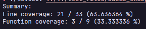
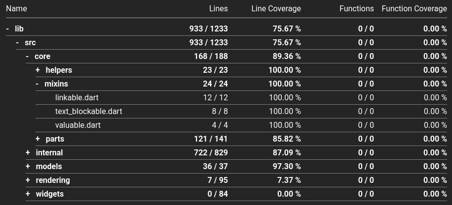
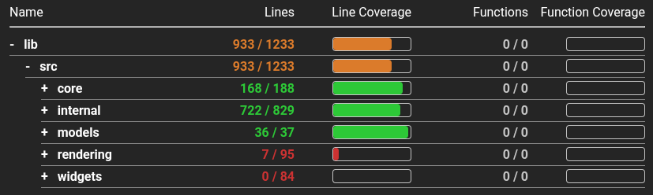
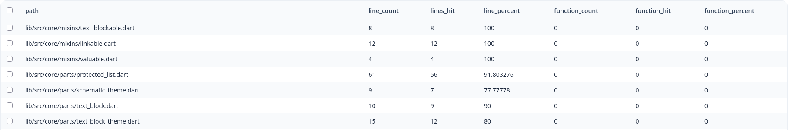

<div align="center">
    
</div>

<div align="center">
    <i>A simple, cross-platform lcov parser for generating various output formats.</i>
</div>

<br />

<div align="center">
    <a href="https://crates.io/crates/lovecov">
      
    </a>    
    <a href="https://github.com/alettsy/lovecov/issues">
      
    </a>    
</div>

<div align="center">
    <a href="https://ko-fi.com/W7C027ZZTS">
        
    </a>
</div>

<hr />

Quick links:

- [Installation](#installation)
- [Usage](#usage)
- [Examples](#examples)
- [Screenshots](#screenshots)
- [Contributing](#contributing)
- [Planned Features](#planned-features)

## Installation

### Cargo

The easiest way to install it for your platform is via `cargo`:

```bash
cargo install lovecov
```

### Release builds

You can find pre-built release binaries under the [releases](https://github.com/alettsy/lovecov/releases) page.

After downloading, make sure you add it to your `PATH`!

### Manual build

To manually build it, you can simply do:

```bash
git clone https://github.com/alettsy/lovecov
cd lovecov
cargo build
```

The output should end up in the `target` folder.

## Usage

> [!TIP]
> If you get stuck, run `lovecov --help` !

The `lovecov` CLI is pretty straightforward:

```bash
lovecov <file> <output (optional)>
```

If you do not provide an `output`, it will default to a simple summary printed in the terminal.

All outputs currently supported:

1. `summary` - simple printed summary
2. `html` - single, static HTML file with navigatable tabs
3. `csv` - single CSV file outlining file-level stats

### Output path

You can specify your own output path with `--output-path` or `-o`.

If you provide a file in the path, it will be used instead of the default file (such as `coverage.html`). If you do not provide one, it will output the default file name to that path.

For differentiating between a file and folder, a trailing slash will treat it as a folder. For example:

```bash
# "folder" is considered to be a folder because of the last "/"
--output-path="/path/to/folder/"

# "file" is considered a file because of a missing trailing "/"
--output-path="/path/to/file"
```

### Ignore files/folders

You can provide a matcher to ignore certain files and folders from the output by using the `--ignore` or `-i` flag.

For example, to ignore all text files and also anything in the _manager_ directory:

```bash
--ignore=".txt,manager/"
```

The format is similar to that of a `.gitignore` file, where you can use `*` to match all characters (regex equivalent: `.*`).

A more complex example looks like:

```bash
--ignore=".txt,manager/*/hidden/,*_example,*_hide,mocks/*.dart"
```

This will ignore:

1. All `.txt` files
2. Anything under all `hidden` folders that are found in the `manager` folder
3. Anything with `_example` in the name
4. Anything with `_hide` in the name
5. Anything in the `mocks` folder that ends with `.dart`

### Other flags

You can use the `--html-use-bars` flag to change the HTML to use progress bars instead of a numerical percentage.

### Examples

```bash
# output coverage.html to local directory
lovecov my_lcov.info html
```

```bash
# output to /my/path/to/report.html
lovecov my_lcov.info html --output-path=/my/path/to/report.html
```

```bash
# output to /my/path/to/report.html
# and skip/ignore anything that matches the ignore conditions
lovecov my_lcov.info html --output-path=/my/path/to/report.html --ignore="standard_link_path,*_manager.dart,helper"
```

## Screenshots

### Summary



### HTML




### CSV



## Contributing

All contributions are welcome!

See [CONTRIBUTING](CONTRIBUTING.md) for how.

## Planned features

- [ ] Support for branch data
- [ ] Output: Cobertura XML
- [ ] Output: Coveralls JSON
- [ ] Output: Regular JSON
- [ ] Output: Markdown
- [ ] Output: Pretty print table
